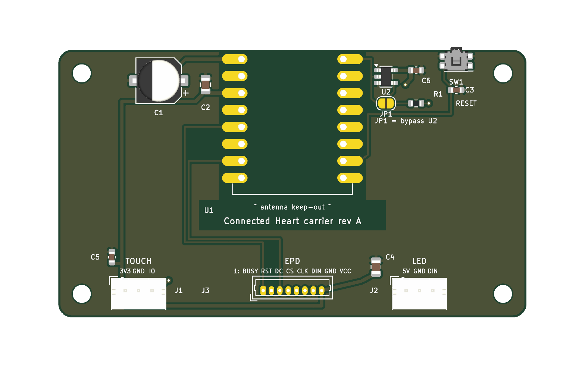
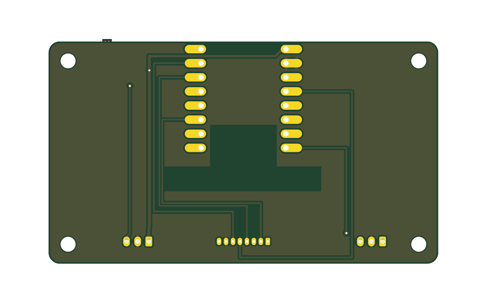

# Connected Heart

A small receive-only messaging device: C++ firmware for an ESP32-C3, a custom carrier PCB in KiCad, and a 3D-printed enclosure.

One trusted person sends a message through a Telegram bot. The heart's LED starts to pulse; when the recipient touches it, the message appears on a 2.13" e-paper display and stays there until the next one arrives. The heart never sends anything back.

<!-- TODO: photo of the finished device here (front, LED lit) -->
<!--  -->

| Carrier PCB (top) | Carrier PCB (bottom) |
|---|---|
|  |  |

## Highlights

- All application logic sits behind abstract interfaces (display, LED, touch sensor, message source, storage, clock, pairing), so the same code runs on the ESP32-C3 and, with fakes, on the host. 58 unit tests run on a laptop without the board.
- Explicit state machine with typed events, tested on the host.
- Setup without instructions: on first boot the device opens a Wi-Fi access point with a captive portal, and the recipient picks a network from their phone. The sender then pairs the device by sending a short code to the bot. Credentials, pairing and the current message are stored in NVS.
- If the device fails to connect five times in a row (about 2.5 minutes), it opens the portal again by itself. A long press on a recessed button does a factory reset.
- Custom 70 × 40 mm two-layer carrier PCB: ESP32-C3 SuperMini on castellated pads, keyed connectors for the display, touch and LED modules, bulk capacitance for Wi-Fi/LED current peaks, a 3.3 V → 5 V level shifter for the WS2812B data line, and an antenna keep-out. ERC and DRC (with schematic parity) pass.
- Five Architecture Decision Records explain the main trade-offs, including alternatives that were considered and not used.

## Architecture

```
            ┌───────────────────────── Application ─────────────────────────┐
            │  StateMachine · MessageManager · LedPatternSelector · Catalog │
            └──┬─────────┬──────────┬──────────┬──────────┬──────────┬──────┘
               │         │          │          │          │          │
        DisplayRenderer  Led   TouchSensor MessageSource MessageStorage Clock   ← interfaces
               │         │          │          │          │          │
  on device:  E-paper  NeoPixel   GPIO     Telegram /    NVS       Arduino
              (GxEPD2)            (TTP223)   Serial
  on host:     Fake      Fake      Fake       Fake        Fake       Fake      ← test/fakes
```

`main.cpp` is the only place where concrete drivers are wired to the `Application`. The `native` PlatformIO environment compiles everything except the hardware drivers, so the logic layer cannot accidentally depend on Arduino.

## Design decisions

| ADR | Decision | Reason |
|---|---|---|
| [0001](firmware/docs/adr/0001-single-pending-message-slot.md) | One pending message; a new one replaces it | E-paper refreshes are slow, and a queue of old messages isn't useful. The sender is told when a message was replaced. |
| [0002](firmware/docs/adr/0002-delivery-acknowledgement-not-read-receipt.md) | The bot confirms delivery, never reading | A read receipt would let the sender track when the recipient reads. |
| [0003](firmware/docs/adr/0003-one-telegram-bot-per-heart.md) | One Telegram bot per device, no backend | No server needed for one pair of devices. The ADR notes where this stops scaling (~20 units). |
| [0004](firmware/docs/adr/0004-setup-and-recovery.md) | Captive portal, pairing code, automatic and manual recovery | The recipient has to be able to set it up and recover it without help. |
| [0005](firmware/docs/adr/0005-always-powered-always-connected.md) | Always powered, no deep sleep | On a 3000 mAh cell, deep sleep would raise battery life from about 1.5 days to one or two months, but it would stop the pulsing LED and instant delivery. |

Terms like Recipient, Sender, Pending Message and Reveal are defined in the [glossary](firmware/docs/glossary.md).

## Repository layout

```
firmware/   PlatformIO project (C++, Arduino framework), unit tests, ADRs
hardware/   BOM, pin map, design notes, KiCad schematic
```

## Build and test

Requires [PlatformIO](https://platformio.org/).

```bash
cd firmware
pio test -e native                    # host unit tests, no hardware needed
cp src/Network/Secrets.example.h src/Network/Secrets.h   # then fill in the bot token
pio run -e esp32-c3-devkitm-1 -t upload
```

`Secrets.h` is git-ignored. Wi-Fi credentials normally come from the captive portal; `-DUSE_COMPILED_CREDENTIALS` in `platformio.ini` skips the portal for bench work.

Hardware: the schematic is in `hardware/kicad/` (KiCad 10, with a PDF in `preview/`). `hardware/kicad/README.md` has the verification notes and the board layout description.

## Hardware

| Part | Role |
|---|---|
| ESP32-C3 SuperMini | MCU, Wi-Fi, USB-C power and flashing |
| 2.13" e-paper (SSD1680-class) | Message display; keeps the image without power |
| TTP223 capacitive touch module | Reveal gesture, through the case wall |
| 3× WS2812B | Notification pulse |

Full bill of materials with part numbers: [`hardware/BOM.md`](hardware/BOM.md).

## Status

Built and working: carrier PCB rev A fabricated, assembled and mounted in the enclosure (v1.3). Firmware is
feature-complete for v1 (provisioning, pairing, Telegram delivery, reveal, persistence, recovery); a few
display/UI refinements are still open.

## Tech

C++ (gnu++11) · ESP32-C3 · PlatformIO · Arduino · GxEPD2 · Adafruit NeoPixel · UniversalTelegramBot · ArduinoJson · Unity (tests) · KiCad 10
